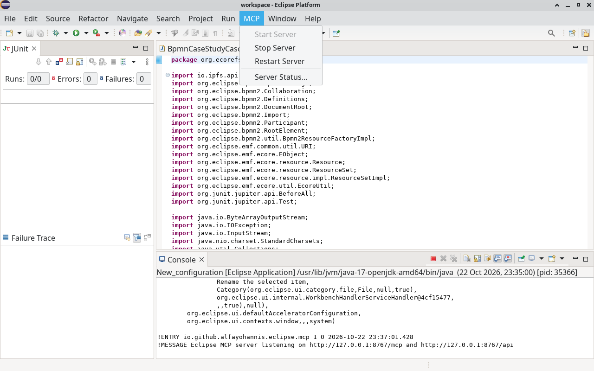
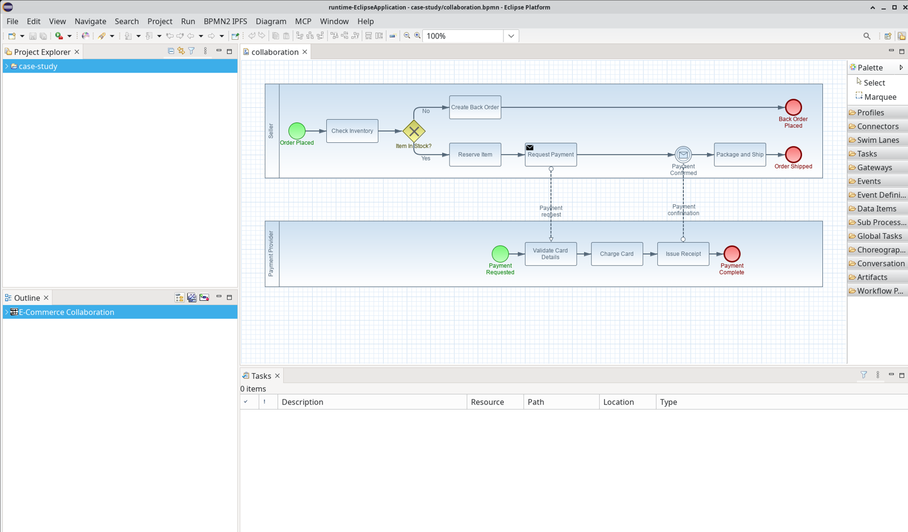

# Tutorial: install and activate eclipse-mcp for the BPMN2 Modeler

[eclipse-mcp](https://github.com/alfa-yohannis/eclipse-mcp) lets an AI assistant such as Claude Code, or a script, work with a running Eclipse. It reads the workspace and the problem markers, runs commands, clicks menus and dialog buttons, takes screenshots, and edits BPMN2 diagrams. This guide covers four tasks:

1. Install the plug-in into the IDE of the [main tutorial](tutorial.md).
2. Activate it in the BPMN2 Modeler that the IDE launches.
3. Connect Claude Code.
4. Try it on the case study of Part 5 of the main tutorial.

The full guide to the plug-in, with every menu, command and diagram tool, is `docs/tutorial.md` in the eclipse-mcp repository.

The setup was used on 2026-10-22 with the setup of the main tutorial and eclipse-mcp 0.1.0. Every output below comes from that session. The modeler kept its workspace in a temporary folder named `runtime-EclipseApplication`, and the outputs shorten temporary paths with `…`, as in `…/runtime-EclipseApplication`.

## Contents

- [Before you start](#before-you-start)
- [Part 1. Install the plug-in into the IDE](#part-1-install-the-plug-in-into-the-ide)
  - [Build and install](#build-and-install)
  - [Restart the IDE](#restart-the-ide)
- [Part 2. Activate it in the BPMN2 Modeler](#part-2-activate-it-in-the-bpmn2-modeler)
  - [Launch the modeler](#launch-the-modeler)
  - [Check that the modeler answers](#check-that-the-modeler-answers)
- [Part 3. Connect Claude Code](#part-3-connect-claude-code)
  - [Register the launcher](#register-the-launcher)
  - [Pin the modeler (optional)](#pin-the-modeler-optional)
- [Part 4. Try it on the case study](#part-4-try-it-on-the-case-study)
- [Stop, switch off or remove the plug-in](#stop-switch-off-or-remove-the-plug-in)
- [Troubleshooting](#troubleshooting)

## Before you start

- The IDE of Part 2 of the main tutorial: Eclipse 2022-06 in `eclipse.2022.06`, running on Java 17, with the modeler projects imported. The BPMN2 Modeler brings Graphiti, which the diagram tools need.
- An X11 session, as for the main tutorial. Screenshots and mouse input need X11.
- `java` on the `PATH`. The client builds itself on its first run, with Maven when Maven is installed and with plain `javac` otherwise.
- Claude Code, for Part 3.
- The repository, next to ecorefs:

  ```bash
  cd /data2/projects
  git clone https://github.com/alfa-yohannis/eclipse-mcp.git
  ```

The commands of this guide run from `/data2/projects/eclipse-mcp`.

## Part 1. Install the plug-in into the IDE

### Build and install

`build.sh` compiles the two bundles of the plug-in against an Eclipse installation, and `--install` copies them into the `dropins` folder of that installation:

```bash
./build.sh /data2/projects/ecorefs/eclipse.2022.06 --install
```

```
Built build/io.github.alfayohannis.eclipse.mcp_0.1.0.202610221633.jar
Built build/io.github.alfayohannis.eclipse.mcp.graphiti_0.1.0.202610221633.jar
Installed into /data2/projects/ecorefs/eclipse.2022.06/dropins; restart Eclipse to load the plug-ins
```

The first jar is the server with the tools for the IDE, the MCP menu and the preference page. The second jar adds the diagram tools for Graphiti editors such as the BPMN2 Modeler. A new install replaces the jars of an older build, and the version ends in the build time.

### Restart the IDE

Choose **File > Restart**. Eclipse reads `dropins` only at start-up. After the restart, the IDE has an **MCP** menu, and its server listens on `http://127.0.0.1:8765`, or on the next free port up to 8774 when another Eclipse holds 8765. The server answers only on 127.0.0.1, and every request needs the token in `~/.config/eclipse-mcp/token`, which the plug-in writes on its first start.

## Part 2. Activate it in the BPMN2 Modeler

### Launch the modeler

Launch the modeler as in Part 2 of the main tutorial: right-click `org.eclipse.bpmn2.modeler.ui` and choose **Run As > Eclipse Application**, then click **Continue** in the **Validation** dialog. Nothing else is needed. The launch configuration of the modeler starts every plug-in of the IDE's target platform (**Launch with: all workspace and enabled target plug-ins** on its **Plug-ins** tab), and the target platform of the IDE includes the plug-ins in `dropins`. The modeler therefore starts its own server on the next free port.

The **Console** of the IDE shows the start of that server. The screenshot below comes from a test launch with a new **Eclipse Application** configuration and default settings; its server took port 8767, because two other Eclipse instances held 8765 and 8766:



### Check that the modeler answers

`./eclipse-mcp instances` lists every running Eclipse with the plug-in. In the test launch above, the IDE answered on 8765 and the launched Eclipse on 8767 (paths shortened; a third Eclipse that ran at the same time is left out):

```
http://127.0.0.1:8767  pid 35366  …/runtime-New_configuration  since 2026-10-22T16:37:01.399783115Z
http://127.0.0.1:8765  pid 34434  …/workspace  since 2026-10-22T16:34:21.806586625Z
```

Without options, the client talks to the newest Eclipse, which is usually the modeler, because you start it after the IDE. To pick the modeler explicitly, name its workspace folder before the command:

```bash
./eclipse-mcp --workspace runtime-EclipseApplication status
```

```
Eclipse MCP 0.1.0.202610221633 at http://127.0.0.1:8765 (33 tools)
Eclipse 4.24.0.v20220607-0700, Java 17.0.20.1
Workspace …/runtime-EclipseApplication with 1 projects
Window: runtime-EclipseApplication - case-study/collaboration.bpmn - Eclipse Platform
#0 runtime-EclipseApplication - case-study/collaboration.bpmn - Eclipse Platform [default]
```

In this run, no IDE server was running, so the modeler held port 8765. The option finds the modeler whatever its port, because only its workspace path contains `runtime-EclipseApplication`.

## Part 3. Connect Claude Code

### Register the launcher

```bash
claude mcp add eclipse -s user -- /data2/projects/eclipse-mcp/eclipse-mcp mcp
```

```
Added stdio MCP server eclipse with command: /data2/projects/eclipse-mcp/eclipse-mcp mcp to user config
File modified: /home/alfa/.claude.json
```

```bash
claude mcp list
```

```
eclipse: /data2/projects/eclipse-mcp/eclipse-mcp mcp - ✔ Connected
```

The launcher finds the running Eclipse and reads the token by itself, so the token never enters the Claude Code configuration. Claude Code reads its servers when a session starts, so start a new session before you use the tools. Their permission names look like `mcp__eclipse__diagram_info`.

### Pin the modeler (optional)

The entry above talks to the newest Eclipse. A second entry can name the modeler, so it never reaches the IDE by accident:

```bash
claude mcp add eclipse-modeler -s user -- \
  /data2/projects/eclipse-mcp/eclipse-mcp --workspace runtime-EclipseApplication mcp
```

This entry was not added during the session of this guide. The same launcher command, started by hand, answered the MCP handshake, listed 33 tools and reported the workspace `…/runtime-EclipseApplication`.

## Part 4. Try it on the case study

Copy the three files of `examples/case-study` into a project `case-study` of the modeler and open `collaboration.bpmn`, as in Part 5 of the main tutorial. Then list the elements of the open diagram:

```bash
./eclipse-mcp --workspace runtime-EclipseApplication diagram
```

```
collaboration  /case-study/collaboration.bpmn
  Participant_Seller  Participant  "Seller"  at 50,50 size 1180x200
  StartEvent_Order  StartEvent  "Order Placed"  at 100,132 size 36x36
  Task_CheckInventory  Task  "Check Inventory"  at 180,125 size 110x50
  ...
  Task_RequestPayment  SendTask  "Request Payment"  at 600,175 size 110x50
  Event_PaymentConfirmed  IntermediateCatchEvent  "Payment Confirmed"  at 917,182 size 36x36
  ...
  Participant_PaymentProvider  Participant  "Payment Provider"  at 50,340 size 1180x140
  ...
  MessageFlow_PaymentRequest  MessageFlow  Task_RequestPayment -> Task_ValidateCard
  MessageFlow_PaymentConfirmation  MessageFlow  Task_IssueReceipt -> Event_PaymentConfirmed
```

The output lists 33 lines, one per shape and connection; `...` marks the lines left out here. The elements inside the pools come from `order-process.bpmn` and `payment-process.bpmn`, which the collaboration draws through its imports.

The plug-in also takes screenshots of the window, a dialog or a single widget:

```bash
./eclipse-mcp --workspace runtime-EclipseApplication screenshot collaboration.png --target window
```

```
Saved …/collaboration.png: the window "runtime-EclipseApplication - case-study/collaboration.bpmn - Eclipse Platform"
```

The client saves the file in the current folder and prints its full path.



In Claude Code, the same tools answer requests such as "list the elements of the diagram that is open in the modeler" or "take a screenshot of the modeler window". The full guide in the eclipse-mcp repository shows how the diagram tools create, connect, move, rename and delete elements.

## Stop, switch off or remove the plug-in

- **MCP > Stop Server** stops the server of one Eclipse, and **MCP > Start Server** starts it again. **MCP > Server Status...** shows the addresses, the port and the client setups. Its REST line contains the real token, so mask it before you share a screenshot of that dialog.
- **Window > Preferences > MCP Server** holds the port and **Start the server when Eclipse starts**. The settings are stored per workspace, so you can switch the server off in the IDE and keep it on in the modeler.
- To remove the plug-in, delete the two `io.github.alfayohannis.eclipse.mcp` jars from `eclipse.2022.06/dropins`, restart the IDE and run `claude mcp remove eclipse -s user`. These steps were not run for this guide.

## Troubleshooting

- **The modeler has no MCP menu.** The IDE ran when the jars were installed, so its target platform lacks them. Restart the IDE and launch the modeler again. If the **Plug-ins** tab of the launch configuration says **plug-ins selected below only**, tick `io.github.alfayohannis.eclipse.mcp` and `io.github.alfayohannis.eclipse.mcp.graphiti` there, or switch to **all workspace and enabled target plug-ins**.
- **A command reaches the IDE instead of the modeler.** Put `--workspace runtime-EclipseApplication` before the command, or set `ECLIPSE_MCP_WORKSPACE=runtime-EclipseApplication`. `./eclipse-mcp instances` shows which Eclipse runs on which port.
- **The client reports that no running Eclipse announces itself.** No Eclipse with the plug-in runs, or its server is stopped. Choose **MCP > Start Server** in the Eclipse you want.
- **The diagram tools are missing.** Both jars must be in `dropins`. The second one needs Graphiti, which the BPMN2 Modeler installs.
