# Tutorial: BPMN models on IPFS with the Eclipse BPMN2 Modeler

This tutorial covers five tasks:

1. Run two local IPFS nodes (Kubo), open the web interface and find a file.
2. Run the Eclipse BPMN2 Modeler with the ecorefs IPFS plug-ins.
3. Create a BPMN model and save it to Kubo.
4. Load a model from Kubo.
5. Follow a change through references between models with the cascade, in the modeler and in the core plug-in, and see what it gets right and where it fails.

The setup was used on 2026-10-22 and 2026-10-23 with Ubuntu 24.04 (X11 desktop), OpenJDK 17.0.20.1, Eclipse 4.24 (2022-06), Docker with Compose, and Kubo 0.40.1.

## Contents

- [Before you start](#before-you-start)
- [Part 1. Run Kubo, open the web interface and find a file](#part-1-run-kubo-open-the-web-interface-and-find-a-file)
  - [Start two local nodes](#start-two-local-nodes)
  - [Load the web interface once](#load-the-web-interface-once)
  - [Open the web interface](#open-the-web-interface)
  - [Find a file](#find-a-file)
- [Part 2. Run the plug-in](#part-2-run-the-plug-in)
  - [Import the projects](#import-the-projects)
  - [Launch the modeler](#launch-the-modeler)
- [Part 3. Create a model and save it to Kubo](#part-3-create-a-model-and-save-it-to-kubo)
  - [Create the model](#create-the-model)
  - [Check the connection settings](#check-the-connection-settings)
  - [Publish the model](#publish-the-model)
  - [Publish a whole project](#publish-a-whole-project)
  - [Publish under an IPNS name (optional)](#publish-under-an-ipns-name-optional)
- [Part 4. Load a model from Kubo](#part-4-load-a-model-from-kubo)
  - [Open one model](#open-one-model)
  - [Open the latest version by name](#open-the-latest-version-by-name)
  - [Open a whole project](#open-a-whole-project)
- [Part 5. References between models: the cascade](#part-5-references-between-models-the-cascade)
  - [The case study](#the-case-study)
  - [Open the case study in the modeler](#open-the-case-study-in-the-modeler)
  - [Edit a model and publish it with cascade](#edit-a-model-and-publish-it-with-cascade)
  - [When the cascade stops](#when-the-cascade-stops)
  - [Run the cascade in the core plug-in](#run-the-cascade-in-the-core-plug-in)
  - [What works](#what-works)
  - [What goes wrong](#what-goes-wrong)
    - [A single publication leaves stale references](#a-single-publication-leaves-stale-references)
    - [The cascade grows with the graph](#the-cascade-grows-with-the-graph)
    - [Cycles cannot be fixed](#cycles-cannot-be-fixed)
    - [IPNS names avoid the cascade but give up the fixed version](#ipns-names-avoid-the-cascade-but-give-up-the-fixed-version)
- [Troubleshooting](#troubleshooting)
- [Next steps](#next-steps)

## Before you start

- A JDK 17. On Ubuntu: `sudo apt install openjdk-17-jdk`, then `sudo update-java-alternatives --set java-1.17.0-openjdk-amd64` if another Java is the default. The modeler plug-ins require JavaSE-17.
- Docker with the Compose plugin, to run Kubo.
- An Eclipse IDE 2022-06 with the Plug-in Development Environment (PDE) and Maven integration (m2e), for example the "Eclipse IDE for RCP and RAP Developers" package. Add the BPMN 2.0 metamodel, Graphiti, GEF and the Web Tools SSE editors through **Help > Install New Software** from `https://download.eclipse.org/releases/2022-06`. Let `eclipse.ini` start Eclipse on Java 17 with two lines before `-vmargs`:

  ```
  -vm
  /usr/lib/jvm/java-17-openjdk-amd64/bin/java
  ```

- The two Eclipse repositories with the IPFS changes:

  ```bash
  git clone https://github.com/alfa-yohannis/org.eclipse.bpmn2-ecorefs
  git clone https://github.com/alfa-yohannis/org.eclipse.bpmn2-modeler-1.5.4-ecorefs
  ```

## Part 1. Run Kubo, open the web interface and find a file

### Start two local nodes

The ecorefs repository starts two Kubo nodes in Docker that form a private IPFS network. Both nodes hold the same secret swarm key, so they connect to each other and refuse every node of the public IPFS network. Your models stay on your machine, and the second node shows that a model added to one node can be read on the other.

From the root of the ecorefs repository, create the key once, start the nodes and let them find each other:

```bash
sh docker/kubo/new-swarm-key.sh
docker compose -f docker/kubo/compose.yaml up -d
sh docker/kubo/peer-nodes.sh
```

`peer-nodes.sh` writes the peer ID of each node into the configuration of the other node. A node gets its ID on its first start, so run the script once after the first `up`, and again after adding a node to `compose.yaml`.

| Node | Container | Kubo API and web interface | Gateway |
|---|---|---|---|
| 1 | `ecorefs-kubo` | `http://127.0.0.1:5001` | `http://127.0.0.1:8080` |
| 2 | `ecorefs-kubo-2` | `http://127.0.0.1:5002` | `http://127.0.0.1:8081` |

The modeler uses node 1 by default. All ports are bound to `127.0.0.1`, because the API gives full control over a node. Stop the nodes with `docker compose -f docker/kubo/compose.yaml stop` and start them again with `start`. Content and keys stay in the Docker volumes `ecorefs-kubo-1-data` and `ecorefs-kubo-2-data`.

Check that node 1 answers and is connected to node 2:

```bash
curl -s -X POST http://127.0.0.1:5001/api/v0/version
docker exec ecorefs-kubo ipfs swarm peers
```

The second command prints one address, the one of node 2.

Kubo also has an `--offline` mode, in which a node opens no connection to any other node, not even to a node on the same machine. The web interface never connects to an offline node, because it reads the network statistics of the node, so this tutorial uses the private network instead.

### Load the web interface once

Kubo does not ship the files of its web interface. It fetches them by their CID from the IPFS network, which a private network cannot reach, so the address below does not load until you import the files once into node 1. Take them as a CAR archive from a public gateway:

```bash
CID=$(curl -s -o /dev/null -w '%{redirect_url}' http://127.0.0.1:5001/webui/ | sed 's|.*/ipfs/||; s|/.*||')
curl -sL -H 'Accept: application/vnd.ipld.car' -o webui.car \
  "https://gateway.pinata.cloud/ipfs/$CID?format=car&dag-scope=all"
docker exec -i ecorefs-kubo ipfs dag import --pin-roots < webui.car
```

Kubo checks every block of the archive against its hash during the import. The pin keeps the web interface in node 1, and node 2 fetches it from node 1 the first time you open it there.

### Open the web interface

Open **http://127.0.0.1:5001/webui** in a browser for node 1, or **http://127.0.0.1:5002/webui** for node 2. The **Status** page shows how much data the node holds and how many peers it found: one, the other node.

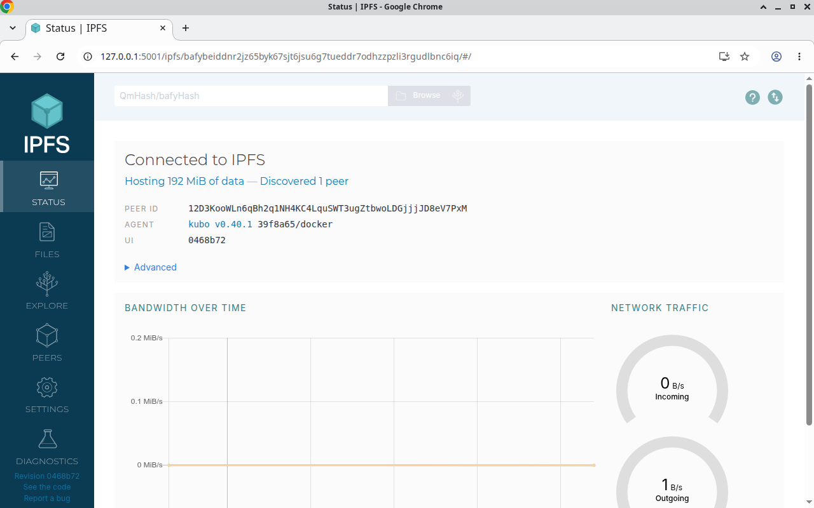

The sidebar leads to the pages **Files**, **Explore**, **Peers**, **Settings** and **Diagnostics**. **Peers** lists the other node in the local network.

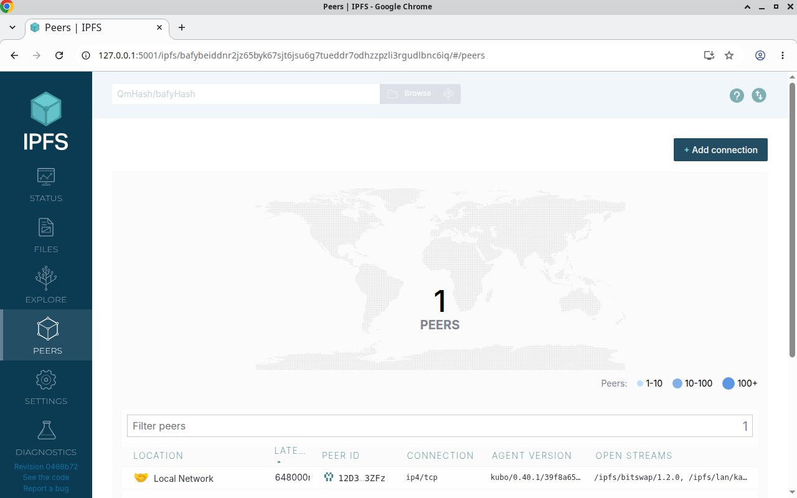

### Find a file

Every file in IPFS is found by its content identifier (CID). To try it, add one of the example models of the ecorefs repository to node 2:

```bash
curl -s -X POST -F "file=@examples/case-study/payment-process.bpmn" \
  http://127.0.0.1:5002/api/v0/add
```

The answer holds the CID in the field `Hash`: `QmSuDF8o9WhaJG2axWcQpWtkJurEuy6JbaKAAsp753agt5`. Any node computes the same CID for the same bytes, and a changed file gets a new CID. Now look the file up through node 1, which fetches it from node 2:

- In the web interface of node 1, paste the CID into the box at the top (`QmHash/bafyHash`).

  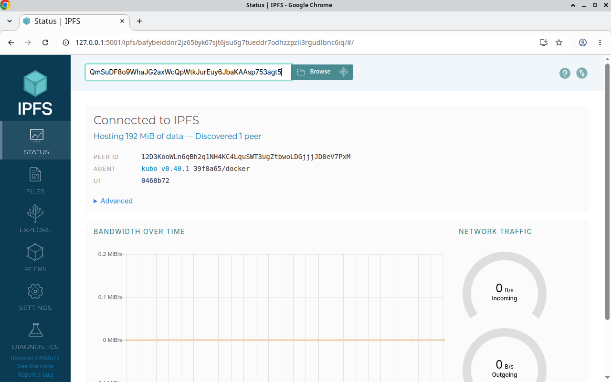

  **Browse** shows the file.

  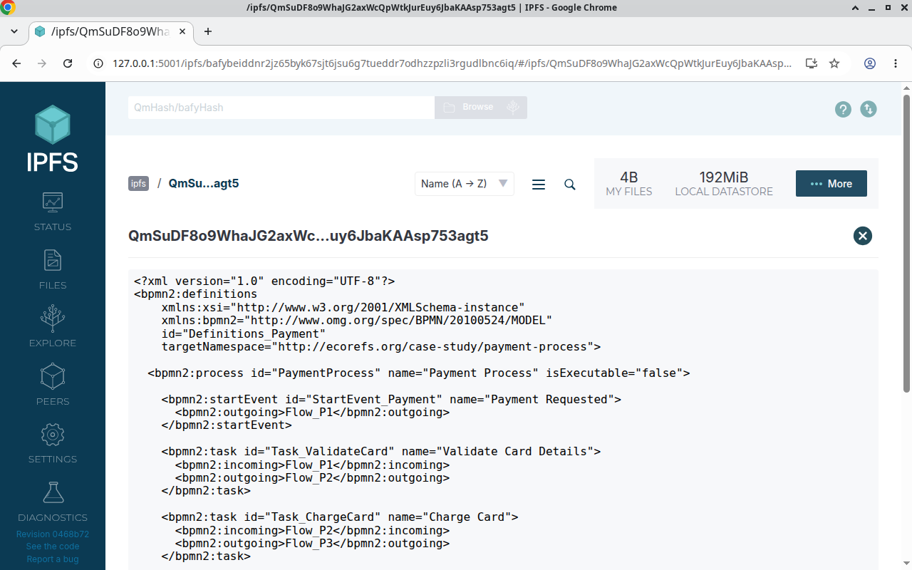

  **Inspect**, the tree icon next to **Browse**, opens the **Explore** page, which shows how the file is stored: one block of 2 kB. **View on Local Gateway** opens the file through the gateway of node 1. **View on Public Gateway** does not work in a private network.

  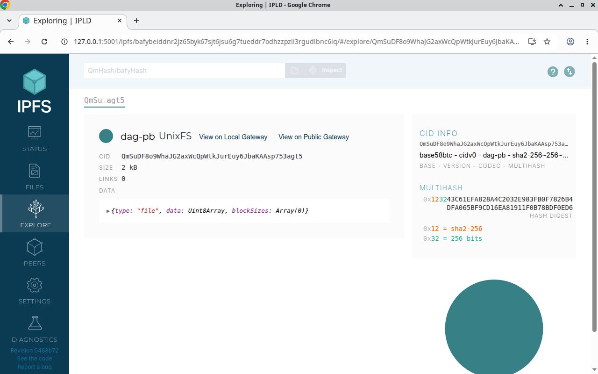

- In the browser, open the gateway address `http://127.0.0.1:8080/ipfs/<CID>`. It shows the BPMN XML of the model.

  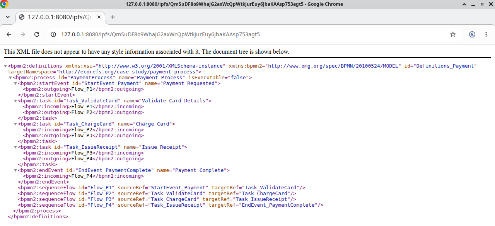

- In the terminal, print the file with `curl -s -X POST "http://127.0.0.1:5001/api/v0/cat?arg=<CID>"`.

Everything a node keeps permanently is pinned. Node 1 keeps a file it fetched from node 2 only in its cache. List the pinned CIDs of a node with:

```bash
docker exec ecorefs-kubo ipfs pin ls --type=recursive
```

## Part 2. Run the plug-in

The IPFS support lives in the plug-ins of the modeler, so the modeler runs as a second Eclipse instance launched from your IDE.

### Import the projects

1. Start Eclipse with a new workspace.
2. Choose **File > Import > General > Existing Projects into Workspace**. Select the `org.eclipse.bpmn2-ecorefs` folder as root directory, tick **Search for nested projects**, select all projects and click **Finish**.
3. Repeat the import for the `org.eclipse.bpmn2-modeler-1.5.4-ecorefs` folder.
4. Wait until the build in the status bar finishes. m2e downloads the Tycho build plug-in from Maven Central on the first build.

The **Problems** view (**Window > Show View > Problems**) then lists many Java warnings from the upstream code, such as raw types and unused imports. Two XML errors in `org.eclipse.bpmn2.modeler.runtime.jboss.jbpm/model/latest` are expected as well: `bpsim.xsd` declares two attributes of type `xs:ID`, and `oursimchanges.xml` holds schema fragments, not a document. Neither file is compiled, so both errors are harmless.

### Launch the modeler

1. Right-click the project `org.eclipse.bpmn2.modeler.ui` and choose **Run As > Eclipse Application**.

   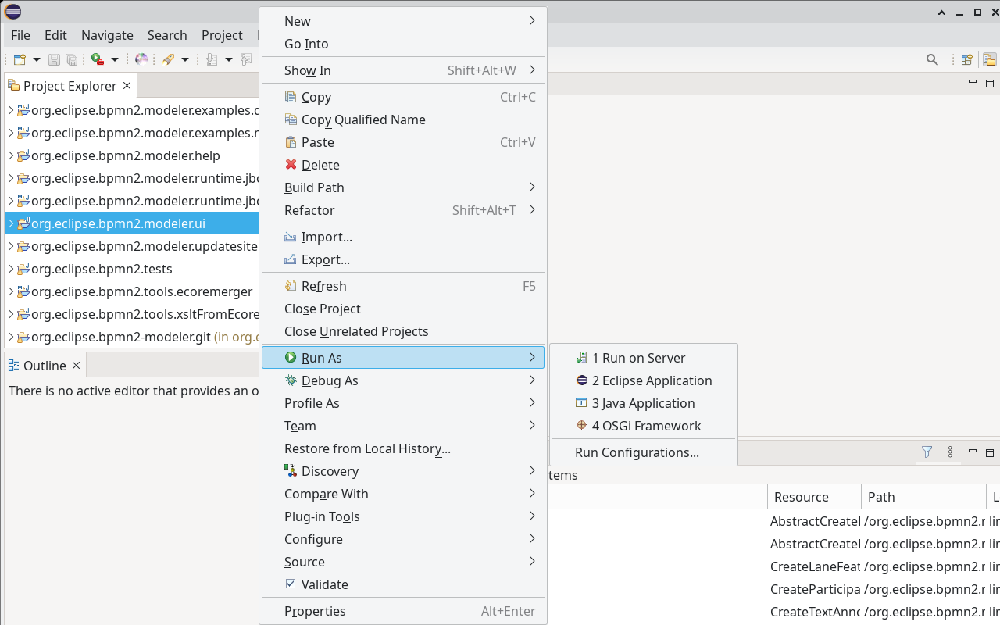

2. Eclipse may show a **Validation** dialog with `Missing Constraint: Require-Capability: osgi.ee` for `org.apache.xml.resolver`. That library ships with Eclipse and declares an old Java version, which the pre-launch check of PDE does not match against Java 17. Click **Continue**. To skip the check in future launches, untick **Validate plug-ins automatically prior to launching** on the **Plug-ins** tab of **Run > Run Configurations**.

   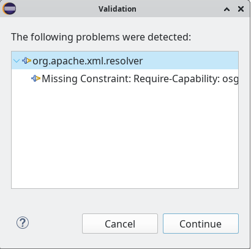
3. A second Eclipse window opens, with a **BPMN2 IPFS** menu in its menu bar. Its workspace is the folder `runtime-EclipseApplication` next to the workspace of your IDE.

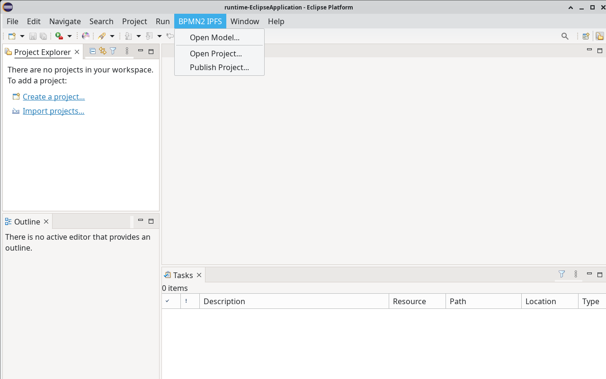

Parts 3 and 4 happen in the second window.

## Part 3. Create a model and save it to Kubo

### Create the model

1. Choose **File > New > Project > General > Project** and name the project `example-01`.
2. Choose **File > New > Other**, type `BPMN` into the filter, select **Generic BPMN 2.0 Diagram** and click **Next**.

   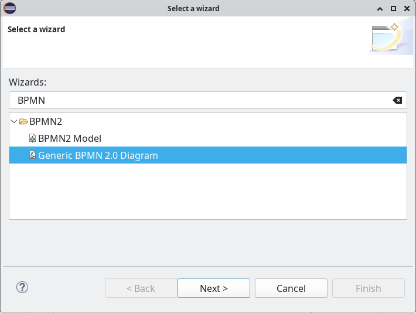

3. Click the **Process** diagram type and then **Next**.

   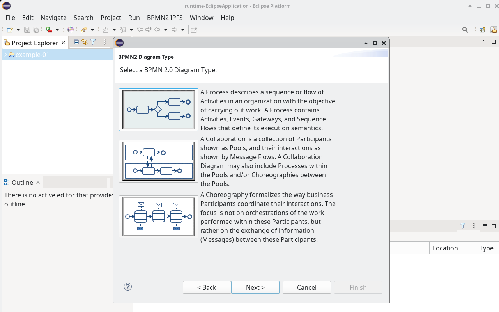

4. With `example-01` selected, the wizard suggests the location `/example-01` and the file name `process_1.bpmn`. Keep both. The wizard also proposes the target namespace `http://org.eclipse.bpmn2/default/process`, and it proposes the same namespace for every new process. Imports, **Open Model** and the cascade of Part 5 tell models apart by their namespace, so give each model its own, for example `http://example.org/example-01/process_1`. Then click **Finish**.

   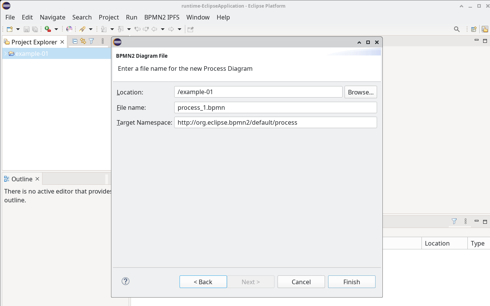

5. The new diagram already holds a start event and an end event joined by a sequence flow. Open the **Tasks** drawer of the palette, choose **Task** and click on the sequence flow: the modeler inserts the task into the flow. To name the task, select it, press F2, type the name and click outside the box. Enter would start a new line of the name. Save with Ctrl+S.

   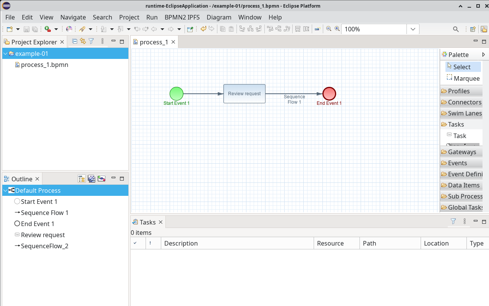

### Check the connection settings

Right-click `example-01` and choose **Properties > BPMN2**. The page holds the IPFS settings of the project:

- **Kubo API URL**, by default `http://127.0.0.1:5001`.
- **Default load reference**, which prefills the open dialog of Part 4.
- **Publish mode**, either `CID` or `IPNS`.
- **Default IPNS publish key name**, used in `IPNS` mode.

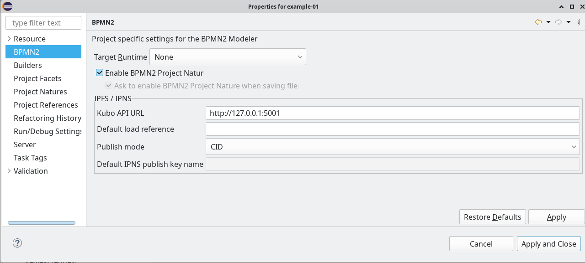

Keep the default URL and `CID` mode. A node at another address can be set for the whole Eclipse instance with the JVM option `-Dorg.eclipse.bpmn2.modeler.ipfs.apiUrl=http://HOST:5001` or the environment variable `BPMN2_MODELER_IPFS_API_URL`, as long as the project keeps the default URL.

### Publish the model

1. Click into the diagram editor of `process_1.bpmn`.
2. Choose **BPMN2 IPFS > Publish Model**. The menu lists **Open Imported Model**, **Publish Model** and **Publish Model with Cascade**, which Part 5 uses, only while a BPMN editor is active.

   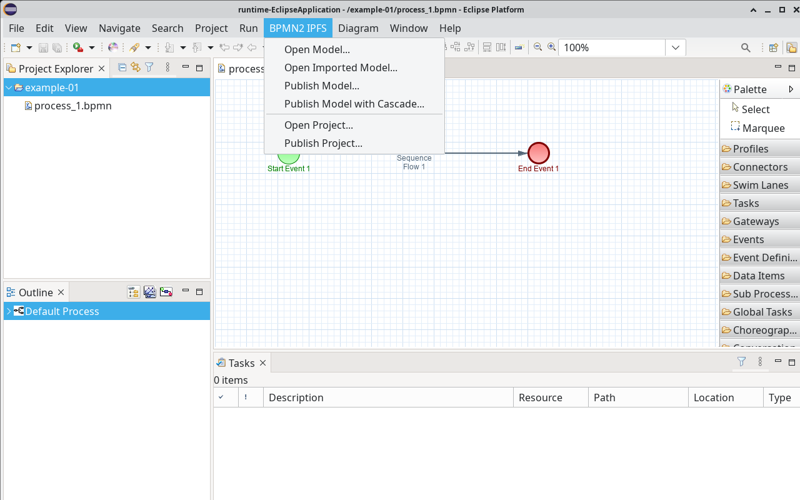

The modeler saves the model first if it has unsaved changes and uploads the `.bpmn` file to Kubo. The dialog **Model Published to IPFS** lists the CID, the `ipfs://` URI, the `/ipfs/` path and the gateway address. **Copy All** copies them. The layout of the diagram is part of the `.bpmn` file (BPMN DI), so the published file carries it.

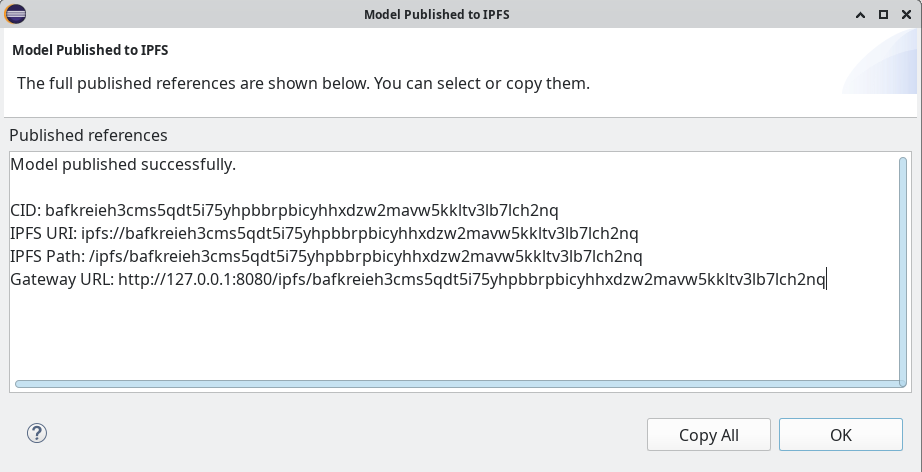

Find the model in Kubo as in Part 1: paste the CID into the web interface, or open the gateway address from the dialog. Node 2 serves it as well, at `http://127.0.0.1:8081/ipfs/<CID>`. Then change the model, save and publish again. The new version gets a new CID, and the old CID still returns the old version.

### Publish a whole project

**BPMN2 IPFS > Publish Project** saves open editors and publishes every `.bpmn` and `.bpmn2` file of the selected project or folder by CID. It publishes them as one set: when a model of the folder imports another one by CID, the import gets the CID that this publication gives the other model, so the files go out in dependency order, as in the cascade of Part 5. After that, it publishes a JSON manifest that maps each relative path to its CID and names the root model. The result dialog shows the CID of the manifest, followed by the files it lists.

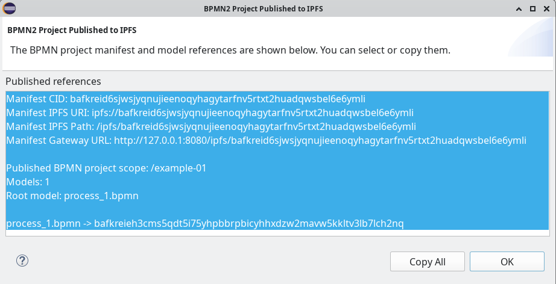

### Publish under an IPNS name (optional)

An IPNS name stays the same while it points to the latest CID.

1. Create a key in the node: `docker exec ecorefs-kubo ipfs key gen bpmn-demo`.
2. In **Properties > BPMN2** of `example-01`, set **Publish mode** to `IPNS` and **Default IPNS publish key name** to `bpmn-demo`.
3. Publish the model again. The dialog now also shows the IPNS name, which points to the new CID.

The IPNS record also reaches node 2 through the DHT of the private network, so node 2 resolves the name to the same CID while both nodes run.

## Part 4. Load a model from Kubo

### Open one model

1. Select the project or folder that should receive the model, for example `example-01`.
2. Choose **BPMN2 IPFS > Open Model** and enter a reference. The dialog accepts a CID (`Qm...` or `bafy...`), `/ipfs/<cid>`, `ipfs://<cid>`, an IPNS name (`k51...`), `/ipns/<name>` or `ipns://<name>`. The example below uses the CID of the payment model from Part 1.

   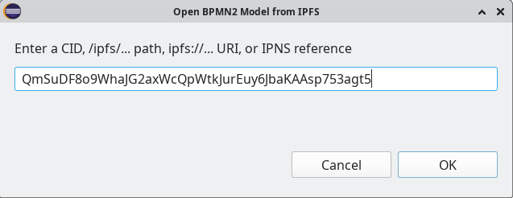

The modeler fetches the BPMN file through Kubo and opens it in the BPMN2 editor. A model that was added to node 2 opens the same way, because node 1 fetches it from node 2.

The file goes into the project of the selected folder, in a folder named after the target namespace of the model. The payment model declares `targetNamespace="http://ecorefs.org/case-study/payment-process"`, so it lands at `ecorefs.org/case-study/payment-process/payment-process.bpmn`. A BPMN import names the model it imports by this namespace, and every version of a model keeps it, so every download of the payment model lands in the same file. When that file already holds the same bytes, the modeler just opens it. When it holds another version, for example one with changes that were never published, the modeler asks whether to replace the file or to open it as it is. A replaced file keeps its old contents in the local history (**Compare With > Local History**).

A model without a target namespace goes into the selected folder instead. A CID does not record the name a file was published under, so the modeler then names the file after the model. It takes the name of the definitions, of the collaboration or of the first process, or else the id of that process. A process left at `Default Process` with an id such as `Process_1` gets one of those placeholders, and the CID is used only when the model has no names at all. A reference that ends in a file name, such as `/ipfs/<cid>/order.bpmn`, keeps that name. When the name is taken, the modeler appends `-1`, `-2` and so on. A temporary file is used only when no workspace location is active.

The payment model has no diagram layout, so the editor first offers to create diagram elements for its process. Keep the selection and click **OK**.

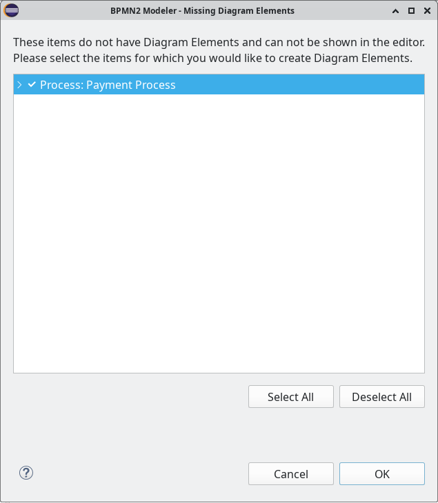

The model then opens from its namespace folder:

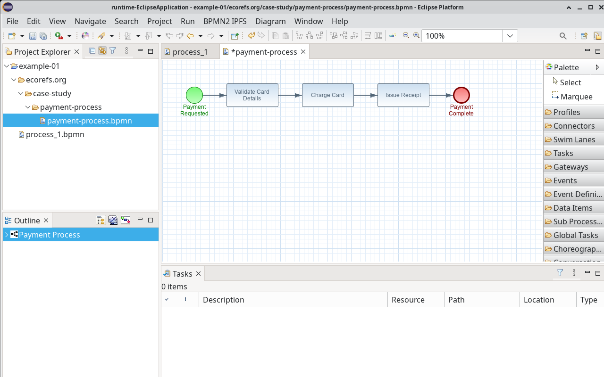

### Open the latest version by name

Enter `ipns://<name>` with the name from the IPNS step of Part 3. After each new publication under that key, the same name returns the newer version.

### Open a whole project

**BPMN2 IPFS > Open Project** takes the CID of a project manifest, restores all listed files into a new folder under the selected project and opens the root model. The files keep the paths they had when the project was published.

When nothing is selected and no BPMN editor is open, for example in an empty Project Explorer, the modeler creates a new project named after the published one, with `-1`, `-2` and so on added if that name is taken. It restores the files into that project, gives the project the BPMN2 nature so models are validated on save, and selects the root model in the Project Explorer. The screenshots below use a new, empty workspace and the manifest CID from Part 3.

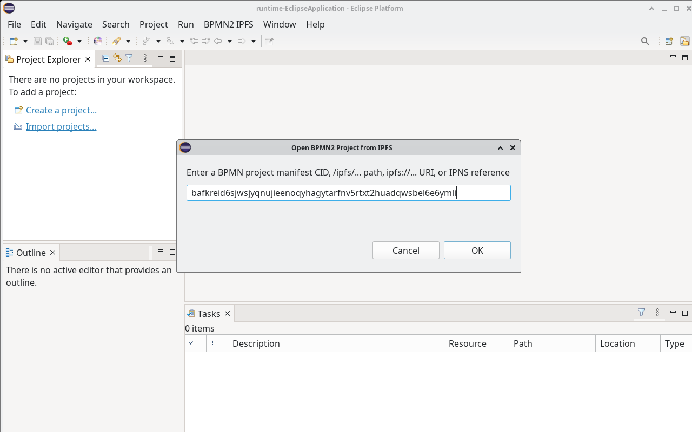

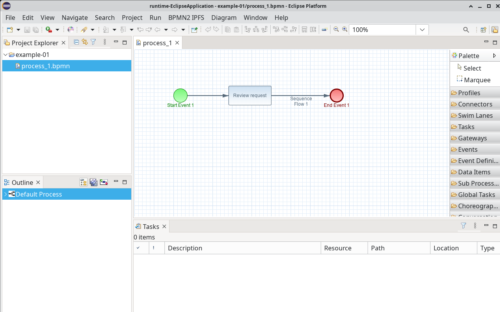

## Part 5. References between models: the cascade

A model can refer to an element of another model. On IPFS, such a reference names the target model by its CID, for example `href="ipfs://QmTLbq…#PaymentProcess"`. Every change to a model gives it a new CID, so the models that refer to it keep pointing to the old version until they are saved again. Each of those saves gives the referring model a new CID too, and the change travels up the chain of references. This is the cascade. In the modeler, **BPMN2 IPFS > Publish Model with Cascade** performs it for BPMN files. In the ecorefs core plug-in, `IPFSResourceImpl.saveIPFSCascaded` performs it for EMF resources.

This part needs node 1 of Part 1 and the modeler of Part 2. The section on the core plug-in also needs a JDK 11 or newer and Maven. The commands run from the root of the ecorefs repository.

### The case study

The folder `examples/case-study` holds three BPMN models. `payment-process.bpmn` stands alone, and `order-process.bpmn` imports the payment process. After Reserve Item, the order process sends a payment request in the send task Request Payment and waits in the message event Payment Confirmed before Package and Ship. In `collaboration.bpmn`, the participant Seller runs the order process and the participant Payment Provider runs the payment process. Two message flows connect the two processes: Payment request goes from Request Payment to Validate Card Details, and Payment confirmation goes from Issue Receipt back to Payment Confirmed. Two reference paths therefore lead from the collaboration to the payment process.

The files refer to each other through BPMN imports. An import binds a namespace to the published version of a file, named by its CID, and an `xmlns` prefix for that namespace lets a reference name an element of the file. The collaboration starts like this:

```xml
<bpmn2:definitions ...
    xmlns:order="http://ecorefs.org/case-study/order-process"
    xmlns:payment="http://ecorefs.org/case-study/payment-process" ...>
  <bpmn2:import importType="http://www.omg.org/spec/BPMN/20100524/MODEL"
      location="ipfs://QmRUrbPL9EVJtnD4RbCheANmQjEpMzcEsE5t8bgvW8utij" namespace="http://ecorefs.org/case-study/order-process"/>
  <bpmn2:import importType="http://www.omg.org/spec/BPMN/20100524/MODEL"
      location="ipfs://QmSuDF8o9WhaJG2axWcQpWtkJurEuy6JbaKAAsp753agt5" namespace="http://ecorefs.org/case-study/payment-process"/>
  <bpmn2:collaboration id="Collaboration_ECommerce" name="E-Commerce Collaboration">
    <bpmn2:participant id="Participant_Seller" name="Seller" processRef="order:OrderFulfillmentProcess"/>
    <bpmn2:participant id="Participant_PaymentProvider" name="Payment Provider" processRef="payment:PaymentProcess"/>
    <bpmn2:messageFlow id="MessageFlow_PaymentRequest" name="Payment request"
        sourceRef="order:Task_RequestPayment" targetRef="payment:Task_ValidateCard"/>
```

The diagram part of the collaboration uses the same prefixes. A shape with `bpmnElement="order:Task_ReserveItem"` draws a task of `order-process.bpmn` inside the Seller pool. Each process therefore stays defined in its own file, and the collaboration holds only the participants, the message flows and the layout. `order-process.bpmn` imports `payment-process.bpmn` in the same way, but none of its elements refers into that file: the import itself is the link between the two processes. When the core plug-in stores the models as XMI, each of these references names its target by CID instead of a prefix.

The files in `examples/case-study` are published versions themselves. The payment process was published first, then the order process with the CID of the payment process in its import, and the collaboration last with both CIDs. A file read from IPFS can therefore find its imports on IPFS too. Node 1 has to hold the three files before the modeler opens them, and adding them gives the CIDs in the imports, because the CID follows from the bytes:

```bash
for model in payment-process order-process collaboration; do
  curl -s -X POST -F "file=@examples/case-study/$model.bpmn" http://127.0.0.1:5001/api/v0/add
done
```

### Open the case study in the modeler

1. Create a project for the case study: **File > New > Project > General > Project**, named `case-study`.
2. Select `case-study`, choose **BPMN2 IPFS > Open Model**, enter the CID of the collaboration, `QmeKugsytfzkk1JZr8SUv7pFoGWPRpox3sE5eJK6ieZZUc`, and click **OK**.

As in Part 4, the modeler stores the collaboration in the folder of its namespace, `ecorefs.org/case-study/collaboration/collaboration.bpmn`. The editor reads the two imports and loads the order process and the payment process from IPFS, by the CIDs in their locations. It draws both processes inside the pools Seller and Payment Provider, with the two message flows between them, although neither process is in the project. The screenshots of this part use the zoom 75% of the toolbar and a minimized **Tasks** view.

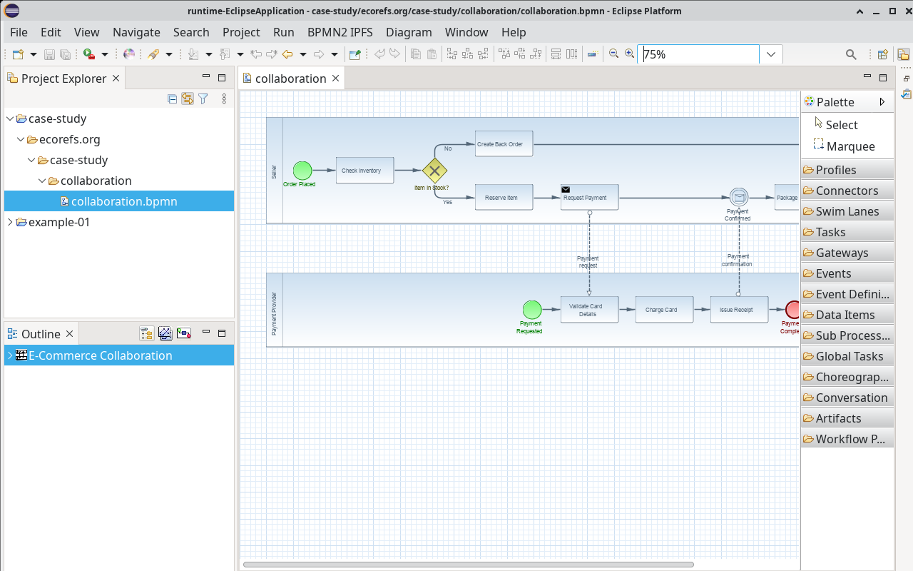

The modeler therefore loads from two places. The file in the editor is a working copy in the workspace. An import with an `ipfs://` location always loads the version it names from IPFS, even when the workspace holds a working copy of that model. An import with a relative location, such as `payment-process.bpmn`, loads the file next to the importing file instead.

### Edit a model and publish it with cascade

To change the payment process, download it first and edit the working copy:

1. With the collaboration in the active editor, choose **BPMN2 IPFS > Open Imported Model**. The dialog lists the imports of the collaboration that load from IPFS, each with its namespace and its location. Select `payment-process` and click **OK**.

   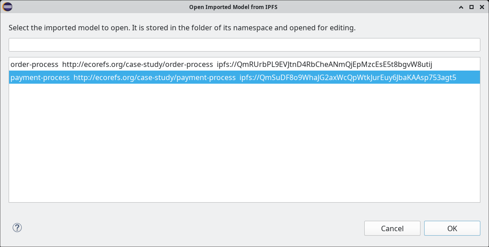

   The model goes to `ecorefs.org/case-study/payment-process/payment-process.bpmn`, as with **Open Model**. It has no diagram layout, so click **OK** in **Missing Diagram Elements**, as in Part 4.
2. Rename the task Validate Card Details to Check Card Details: select it, press F2, type the name and click outside the box.
3. Save with Ctrl+S. On the first save in a plain project, the modeler offers to add the BPMN2 nature. Click **Yes**.

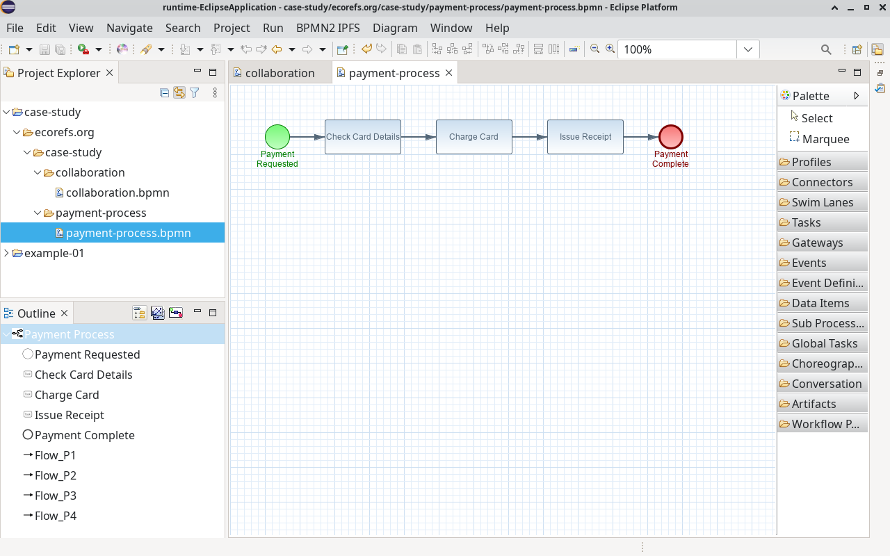

Save writes the working copy only. The collaboration still imports the payment process by its old CID, so its editor still shows Validate Card Details:

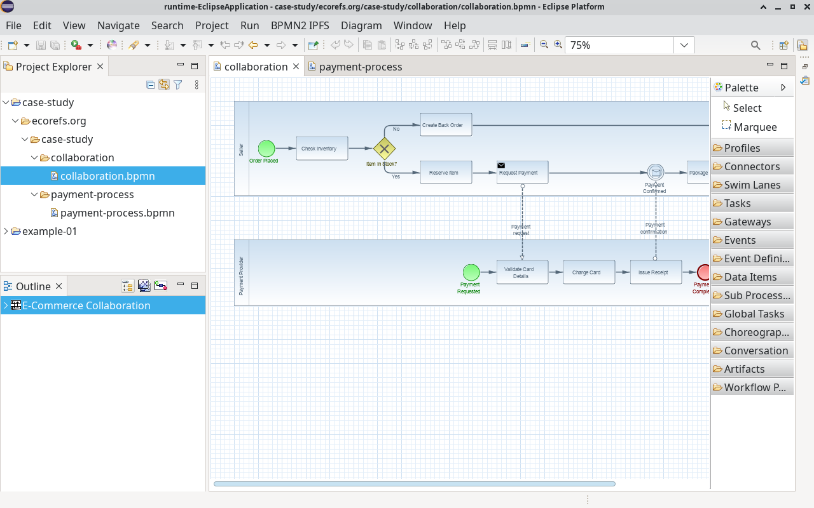

To carry the change to the collaboration, click into the editor of the payment process and choose **BPMN2 IPFS > Publish Model with Cascade**. The command saves the open models of the project and then looks for the models that import the payment process by CID: in the BPMN files of the project, and in the versions that those files pin on IPFS. An import refers to the payment process when it names the namespace of the payment process. Before it publishes anything, the command lists the models that will get a new version:

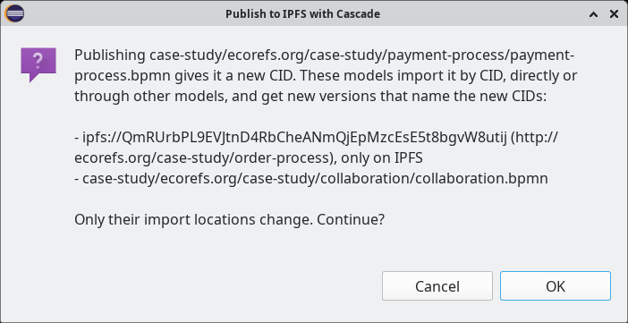

The order process is on the list although the project holds no copy of it. The collaboration pins it by CID, and that version of the order process imports the payment process by CID in turn. Without a new version of the order process, the collaboration would load two versions of the payment process: the new one through its own import, and the old one through the order process.

Click **OK**. The command publishes the payment process first, then the order process and the collaboration last, so every new version names the new CIDs of the models it imports. A new version differs from the old one only in the `location` of its imports. The working copy of the collaboration gets the new locations written into its file, and its comments and layout stay as they were. The order process has no working copy, so the command publishes its new version from the pinned bytes. The dialog lists every publication with its new CID and the import locations that changed:

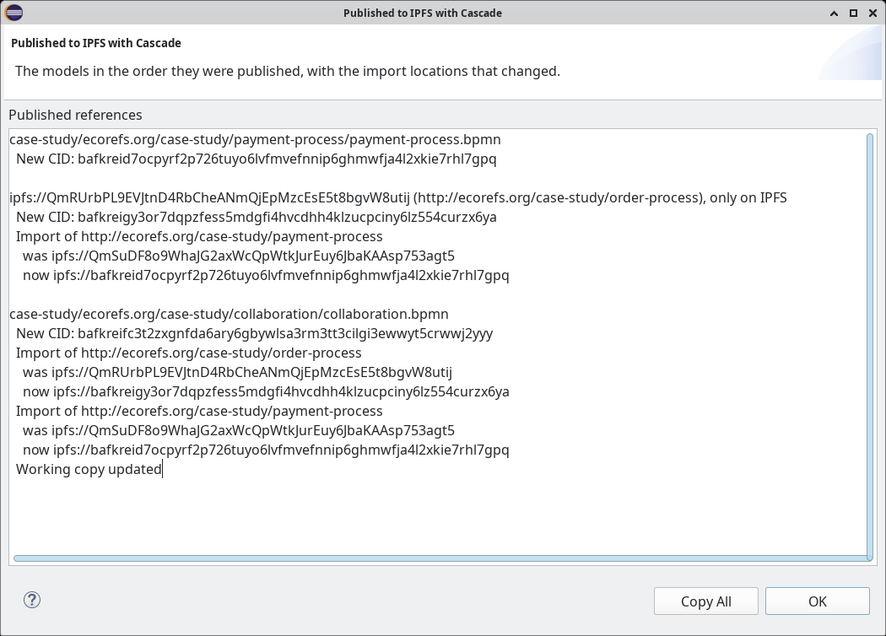

The editor of a rewritten file is closed before the change and opened again afterwards, because the editor keeps the model it loaded and would write the old locations back on its next save. The reopened collaboration loads the new versions and shows Check Card Details:

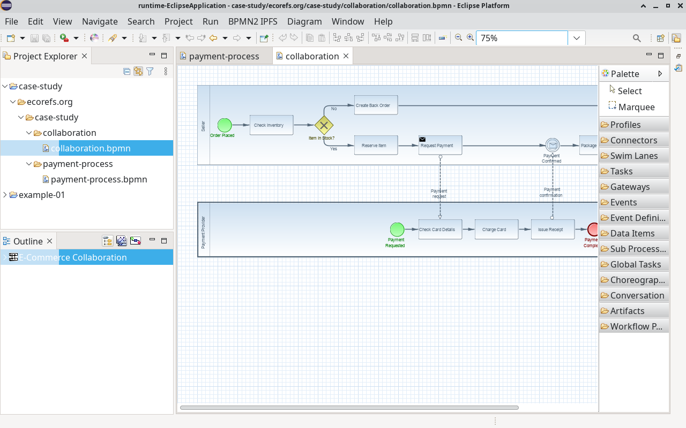

A comparison of the working copy with the published file in the repository shows the two changed locations and nothing else:

```bash
diff examples/case-study/collaboration.bpmn <workspace>/case-study/ecorefs.org/case-study/collaboration/collaboration.bpmn
```

```
27c27
<       location="ipfs://QmRUrbPL9EVJtnD4RbCheANmQjEpMzcEsE5t8bgvW8utij" namespace="http://ecorefs.org/case-study/order-process"/>
---
>       location="ipfs://bafkreigy3or7dqpzfess5mdgfi4hvcdhh4klzucpciny6lz554curzx6ya" namespace="http://ecorefs.org/case-study/order-process"/>
29c29
<       location="ipfs://QmSuDF8o9WhaJG2axWcQpWtkJurEuy6JbaKAAsp753agt5" namespace="http://ecorefs.org/case-study/payment-process"/>
---
>       location="ipfs://bafkreid7ocpyrf2p726tuyo6lvfmvefnnip6ghmwfja4l2xkie7rhl7gpq" namespace="http://ecorefs.org/case-study/payment-process"/>
```

The new CIDs start with `bafk`, because the modeler adds files as CIDv1, while the files in `examples/case-study` were added as CIDv0 and start with `Qm`. Both forms work in import locations. The same edit gives the same CIDs on every run, because a CID follows from the bytes.

### When the cascade stops

The command checks the whole cascade before it publishes or writes anything. It stops, and changes nothing, in three cases:

- Two files of the project declare the namespace of the published model. The imports of that namespace could mean either file.
- An affected import pins a version that differs from the working copy of that model in the project. After the cascade above, open the old order process, `QmRUrbPL9EVJtnD4RbCheANmQjEpMzcEsE5t8bgvW8utij`, which puts a working copy of it into `ecorefs.org/case-study/order-process`, and publish the payment process with cascade again. The collaboration now pins the new order process, the working copy holds the old one, and the command cannot tell which of the two should carry the change:

  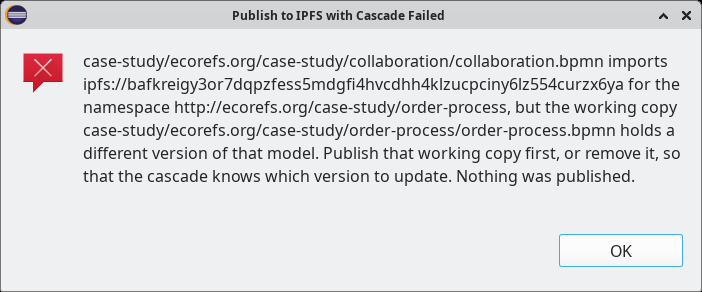

  Publish the working copy first, or delete it if it is not needed.
- Models import each other by CID. No version of either can contain the new CID of the other, as [Cycles cannot be fixed](#cycles-cannot-be-fixed) explains.

The cascade reaches the models of the project and the versions they pin. IPFS cannot list the other models that import a CID, so a model outside the project keeps its old imports until its owner runs the cascade.

### Run the cascade in the core plug-in

The core plug-in stores models as XMI, so the files that it puts on IPFS are the XMI form of the BPMN models. Its cascade rewrites the references, and the import locations have to follow them. EMF treats a location as plain text, so the publication needs an updater for BPMN imports in its options:

```java
Map<String, Object> options = Map.of(IPFSResourceOptions.LOCATION_UPDATERS, List.of(
        new NamespaceImportLocations(Bpmn2Package.Literals.IMPORT__NAMESPACE,
                Bpmn2Package.Literals.IMPORT__LOCATION,
                Bpmn2Package.Literals.DEFINITIONS__TARGET_NAMESPACE)));
payment.saveIPFSCascaded(options);
```

Before each publication, the updater finds the model that declares the namespace of an import and writes its URI into the location: `location="ipfs://<CID>"` in CID mode and `location="ipns://<name>"` in IPNS mode. The cascade also follows imports like references, so a new version of the payment process reaches the order process through its import alone.

The test below maps the CIDs in the imports of `examples/case-study` to the local files, so it reads the models from the repository. The copies that it stores on IPFS are in [`examples/case-study/ipfs`](../examples/case-study/ipfs), in the XMI of the core plug-in.

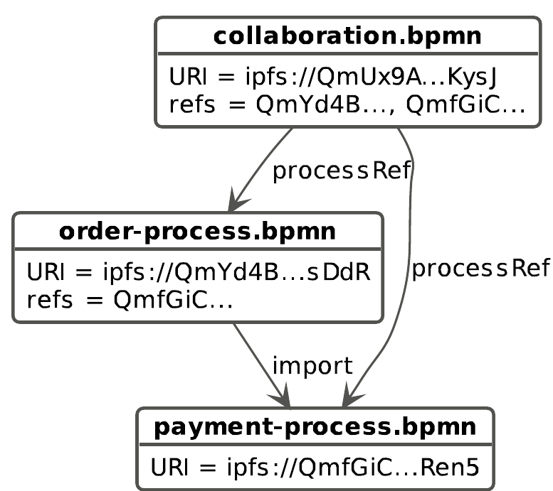

```bash
mvn -q -f core-plugin/pom.xml test -Dtest=BpmnCaseStudyCascadeTest
```

The test loads the three files, publishes them to node 1 with `saveIPFS` and the options above, changes the name of the payment process and calls `saveIPFSCascaded` on it. It prints the CIDs before and after the change:

```
[case study] before the change
[case study]   payment-process.bpmn ipfs://QmfGiCCe3C6dtHFvRtMipQ7c3hxhLZawmrcajgNWavRen5
[case study]   order-process.bpmn ipfs://QmYd4Bacip4qw8tuPhXDCBaP2MmVJmYYKcwusbiZvFsDdR
[case study]   collaboration.bpmn ipfs://QmUx9AWXcwUyVYHXXHyWqn1gk2jmTDLzBS7AohN8qQKysJ
[case study] after the cascade save, 49.76 ms
[case study]   payment-process.bpmn ipfs://QmTLbqPgHxUmS82rDLDCKgrncmkdHi9J6nQu38KT8AE3PJ
[case study]   order-process.bpmn ipfs://QmT1Y8EfDTYi7NJCaqMeMfCk5V45iFjRPWGEVarReWrChc
[case study]   collaboration.bpmn ipfs://QmNxhLjKZ929aWBgga6RzPUDKvyjF7L7kvF1jHNTQ3Aspp
```

The test also runs in Eclipse. Import `core-plugin` with **File > Import > Existing Projects into Workspace**, choose **Maven > Update Project** on it once, open `BpmnCaseStudyCascadeTest` and choose **Run As > JUnit Test**. The **Console** prints the same CIDs, because the same content always gets the same CID. Only the time changes from run to run.

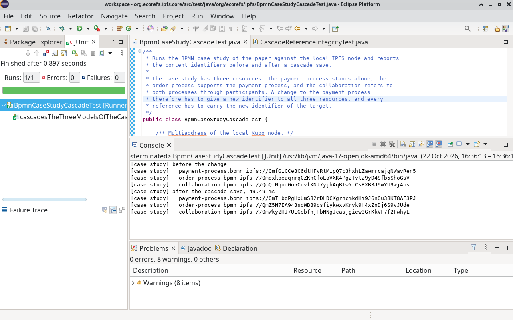

One change gave all three models a new CID. The cascade saves in dependency order: the payment process first, the order process second and the collaboration last, so every rewritten reference finds the new CID of its target. Had the collaboration been saved before the order process, it would carry the old CID of the order process.

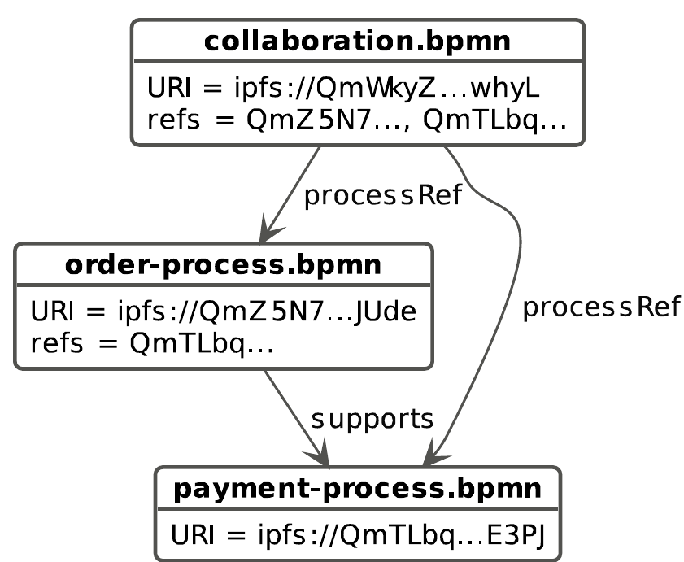

### What works

- Every reference carries the current CID. Open the new collaboration through the gateway: `http://127.0.0.1:8080/ipfs/QmNxhLjKZ929aWBgga6RzPUDKvyjF7L7kvF1jHNTQ3Aspp`. The two import locations, the two `processRef` entries, the ends of the two message flows and the shapes of the diagram all point to the new CIDs of the two processes.

  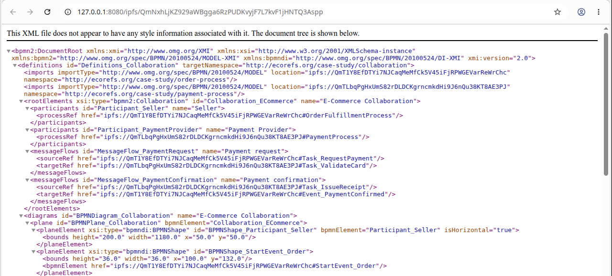

- The old version stays intact. The previous CID of the collaboration still returns the collaboration with the old references, so it reproduces the exact state before the change: `http://127.0.0.1:8080/ipfs/QmUx9AWXcwUyVYHXXHyWqn1gk2jmTDLzBS7AohN8qQKysJ`.

  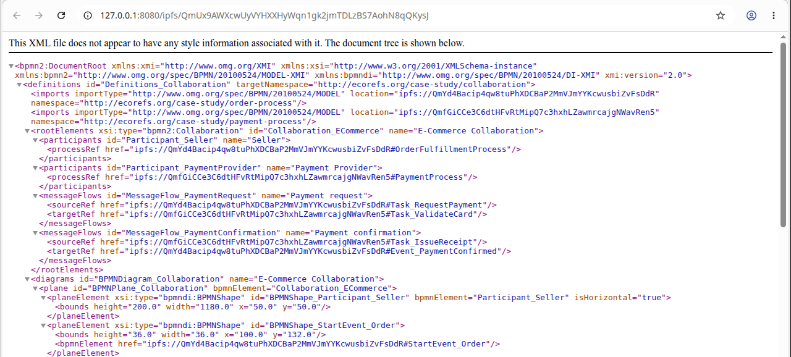

- The run is reproducible. The same files and the same change give the same CIDs on every node. The CIDs above are the ones in the two figures.
- Node 2 serves both versions as well, for example at `http://127.0.0.1:8081/ipfs/QmNxhLjKZ929aWBgga6RzPUDKvyjF7L7kvF1jHNTQ3Aspp`, because it fetches the files from node 1.

### What goes wrong

#### A single publication leaves stale references

`resource.saveIPFS()` publishes one resource. The models that refer to it keep the old CID until someone runs the cascade with `saveIPFSCascaded()`. A plain `resource.save()` is the normal EMF save and writes to the location of the resource URI, so it fails for an `ipfs://` URI, whose content cannot change. The commands below play such a save: they take the payment process, change its name, add it again and look at the order process.

```bash
PAYMENT=QmTLbqPgHxUmS82rDLDCKgrncmkdHi9J6nQu38KT8AE3PJ
ORDER=QmT1Y8EfDTYi7NJCaqMeMfCk5V45iFjRPWGEVarReWrChc
curl -s -X POST "http://127.0.0.1:5001/api/v0/cat?arg=$PAYMENT" \
  | sed 's/second version/third version/' > payment-v3.xmi
curl -s -X POST -F "file=@payment-v3.xmi" http://127.0.0.1:5001/api/v0/add
curl -s -X POST "http://127.0.0.1:5001/api/v0/cat?arg=$ORDER" | grep -o 'location="[^"]*"'
```

The third version of the payment process gets the CID `Qmcjxb3ct1NaLvPTLt1hqBnQw4ZpMTYppxpPenrxdMrnvY`, but the import of the order process still names the second version:

```
location="ipfs://QmTLbqPgHxUmS82rDLDCKgrncmkdHi9J6nQu38KT8AE3PJ"
```

**Publish Model** in the modeler behaves the same way: it uploads one model and rewrites no imports in other models. **Publish Model with Cascade** does.

#### The cascade grows with the graph

A change near the bottom gives a new CID to every model above it. In the case study, one change cost three saves. Package ecosystems know the same cost of pinned versions: a fix in a low-level library reaches an application only after every library in between has released a version that depends on the fix. A model split into thousands of resources, like the MoDisco model of the paper, can need as many saves for one change, and the paper leaves a measurement on such a graph to future work.

#### Cycles cannot be fixed

When two models refer to each other, the cascade has to save one of them first, and that model stores the old CID of the other. A test of the core plug-in shows it:

```bash
mvn -q -f core-plugin/pom.xml test -Dtest=CascadeReferenceIntegrityTest#leavesOneDirectionOfACycleOutdated
```

```
[cycle] first ipfs://QmWmp1eEtjEPaMoN9hQmkf38PDaT74kkPGEuKqSRjXrXWD refers to second ipfs://QmfHiPg7SSSTKxXAcoaJyQqHnzgerE9AR2L6XgPKsGrhU9
[cycle] second ipfs://QmfXGfNjU7V5gKrEHaWRfBGGomdbVPdPDDSiv4rvLUVUBF refers to first ipfs://QmWmp1eEtjEPaMoN9hQmkf38PDaT74kkPGEuKqSRjXrXWD
```

In Eclipse, **Run As > JUnit Test** on `CascadeReferenceIntegrityTest` runs the cycle together with the chain, diamond and chain-of-four cases. All four pass, and the last two lines of the **Console** come from the cycle:

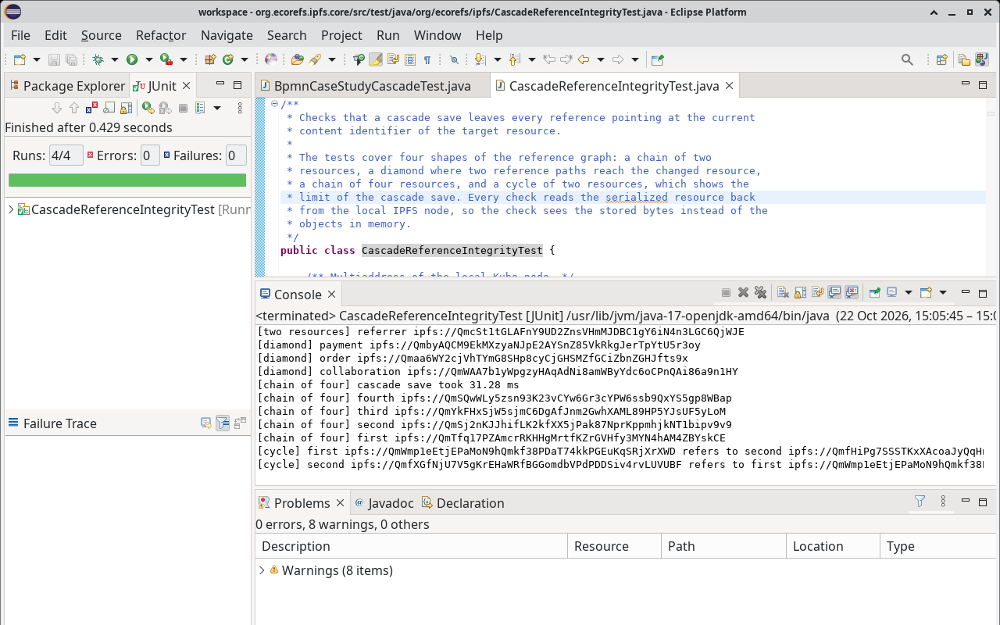

After the cascade, the second model refers to the current first model, but the first model still refers to `QmfHiPg…`, the previous version of the second. A CID is computed from the content, and each model would have to contain the CID of the other, so no save order fixes both directions.

Package managers have lived with the same limit for a long time, for the same reason. A released Maven artifact never changes, just like the content behind a CID. `model-a:1.0` can depend on `model-b:1.0` only if `model-b:1.0` exists already, and then `model-b:1.0` cannot depend on `model-a:1.0` as well. Maven therefore refuses to build modules that depend on each other. Two modules `model-a` and `model-b` that declare each other as dependencies stop the build at once (Maven 3.8.7):

```
[ERROR] The projects in the reactor contain a cyclic reference: Edge between 'Vertex{label='demo:model-b:1.0'}' and 'Vertex{label='demo:model-a:1.0'}' introduces to cycle in the graph demo:model-a:1.0 --> demo:model-b:1.0 --> demo:model-a:1.0
```

Cargo, the package manager of Rust, gives the same answer for two crates that depend on each other (Cargo 1.92):

```
error: cyclic package dependency: package `model-a v1.0.0 (…)` depends on itself. Cycle:
```

Gradle stops a build whose projects depend on each other in a cycle as well, and Go rejects import cycles between packages. These ecosystems keep their dependency graphs free of cycles, and when two parts need each other, the shared part moves into a third artifact that both depend on. Models stored by CID follow the same rule. To break a cycle, move the shared elements into a third model that both refer to, merge the two models into one resource, or let one direction of the cycle refer to an IPNS name.

#### IPNS names avoid the cascade but give up the fixed version

In IPNS mode, a reference carries a name instead of a CID. A new save moves the name to the new CID, and the models that refer to the name need no new save. Two nodes show both sides of the trade-off:

```bash
docker exec ecorefs-kubo ipfs key gen payment-latest
docker exec ecorefs-kubo ipfs name publish --key=payment-latest \
  /ipfs/QmTLbqPgHxUmS82rDLDCKgrncmkdHi9J6nQu38KT8AE3PJ
docker exec ecorefs-kubo-2 ipfs name resolve --nocache <name>
docker exec ecorefs-kubo ipfs name publish --key=payment-latest \
  /ipfs/Qmcjxb3ct1NaLvPTLt1hqBnQw4ZpMTYppxpPenrxdMrnvY
docker exec ecorefs-kubo-2 ipfs name resolve --nocache <name>
```

`<name>` is the `k51…` name that the publish command prints. Node 2 first resolves the name to the second version and, after the new publication, to the third, without any new save of the referring models. However, a model that refers to `ipns://<name>#PaymentProcess` no longer pins the version it was saved with. An old copy of the order process now resolves to the newest payment process, so it no longer reproduces the earlier state. The name also works only while the node that holds its key keeps republishing the record.

| | References by CID with `saveIPFSCascaded` | References by IPNS name |
|---|---|---|
| Referring models after a change | Need new saves, which the cascade performs | Stay unchanged |
| Old versions | Stay reproducible | Resolve to the newest version |
| Cycles | One direction keeps an old CID | Work, because the names stay the same |
| Availability | Any node with the content can serve it | The node with the key must republish the record |

The two modes match the two kinds of versions in Maven. A reference by CID behaves like a dependency on a released version, and a reference by IPNS name like a dependency on a `-SNAPSHOT` version, which always resolves to the newest build. The Maven Release Plugin refuses to release a project that still depends on a SNAPSHOT for the reason given above: the release could not be reproduced later.

## Troubleshooting

- **The web interface does not load.** Node 1 lacks the files of the interface. Import them as described in Part 1.
- **The web interface reports "Could not connect to the Kubo RPC".** The node runs with `--offline` or does not run at all. Start the nodes with Docker Compose as in Part 1.
- **Node 2 cannot open a model or an IPNS name published through node 1.** The nodes are not connected. `docker exec ecorefs-kubo ipfs swarm peers` should print the address of node 2. Start both nodes, and run `sh docker/kubo/peer-nodes.sh` if they still do not see each other.
- **m2e hangs on `http://maven.eclipse.org/nexus/...`.** The host `maven.eclipse.org` no longer answers, but its name still resolves, so every request waits for a timeout. Remove the plugin repositories `eclipse-nexus-central` and `eclipse-nexus-public` from `pom.xml` of `org.eclipse.bpmn2-ecorefs` and from `parent/pom.xml` of the modeler, delete the failure markers with `find ~/.m2/repository -name '*.lastUpdated' -delete`, and run **Maven > Update Project** (Alt+F5) with **Force Update of Snapshots/Releases**.
- **`Unresolveable build extension: Plugin org.eclipse.tycho:tycho-maven-plugin:2.7.5`.** The same cause as above. After the fix, update the projects with **Force Update**, or restart Eclipse first if the marker stays.
- **Eclipse or Maven runs on the wrong Java.** Check `java -version`, `echo $JAVA_HOME` and the `-vm` lines in `eclipse.ini`. All three should point to Java 17.
- **Publishing fails with "Connection refused".** Kubo is not running. Start it with `docker compose -f docker/kubo/compose.yaml start` and check the API with the `curl` command of Part 1.
- **IPNS publishing asks for a key name.** Set **Default IPNS publish key name** in the project properties, and make sure the key exists: `docker exec ecorefs-kubo ipfs key list`.
- **Publish with cascade reports that a working copy holds a different version.** An import pins a version of a model whose working copy in the project has other content, for example changes that were never published. Publish that working copy first, or delete it. [When the cascade stops](#when-the-cascade-stops) shows an example.
- **Opening `collaboration.bpmn` reports "Cannot load Resource" for `payment-process.bpmn`.** Older builds of the modeler fork look for an imported file in the working directory of Eclipse instead of the folder of the importing file. Pull the modeler repository, which resolves import locations against the importing file, let Eclipse rebuild it, and start the runtime again.

## Next steps

The persistence layer of ecorefs also works without the modeler. The section on the core plug-in in the [README](../README.md) shows how to run its tests, and [`examples/BpmnIpfsExample.java`](../examples/BpmnIpfsExample.java) saves two BPMN models to IPFS and resolves a reference between them by CID.

To let an AI assistant such as Claude Code work with the IDE and the modeler, install the eclipse-mcp plug-in as described in [eclipse-mcp.md](eclipse-mcp.md).
